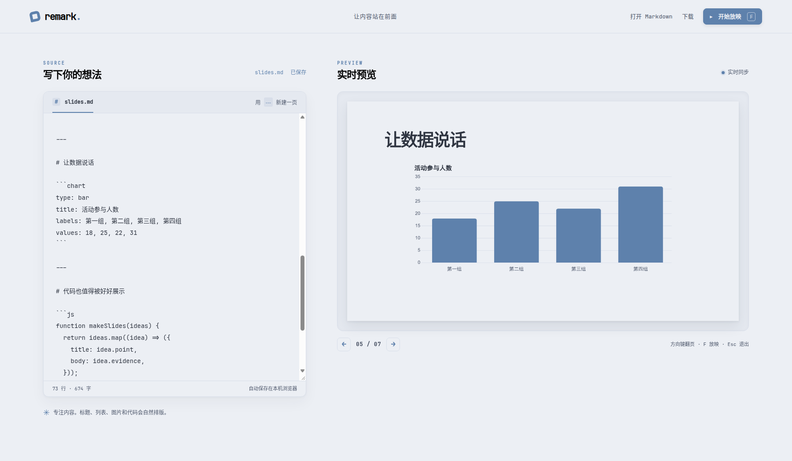

# remark.

一个以内容为主的 Markdown WebPPT 小框架。左侧写 Markdown，右侧实时预览；放映和翻页由 reveal.js 驱动。



界面与幻灯片使用 [Nord Light](https://www.nordtheme.com/) 配色。项目内置 JetBrains Mono Nerd Font 和思源黑体 CN 的 WOFF2 文件，字体授权文件位于 `public/fonts/`。

## 启动

需要 Node.js 22.12+。

```bash
npm install
npm run dev
```

打开终端显示的本地地址（通常是 `http://localhost:5173`）。部署静态页面时运行 `npm run build`，将 `dist/` 放到静态网站即可。

## 命令行

```bash
node bin/remark-ppt.mjs import pwn_binary_security.md
node bin/remark-ppt.mjs present pwn_binary_security.md
```

`import` 把文件载入可编辑的网页，同一次 CLI 会话内刷新页面可恢复浏览器草稿；网页修改不会写回源文件，要保存文件请下载 Markdown。`present` 直接打开放映视图，源文件在编辑器中保存后会自动更新浏览器。浏览器限制自动进入系统全屏时，可再按 `F` 进入全屏。

两个命令都只监听 `127.0.0.1`，默认选择空闲端口。`--no-open` 只输出地址而不启动浏览器，`--port 5175` 可指定端口，`--json` 在标准输出中给出一行包含 `version`、`url`、`mode`、`file` 的 JSON，方便后续 NeoVim 插件通过后台任务调用。插件可解析启动行、打开 `url`，并在退出时向 CLI 进程发送 `SIGTERM`；诊断信息写在标准错误。按 `Ctrl+C` 停止服务。

本仓库的 [Pwn 纳新讲稿](pwn_binary_security.md) 已按 `---` 分页，可直接传给上述命令。

## 写幻灯片

- 每页写普通 Markdown；单独一行 `---` 开始下一页。
- 支持标题、列表、引用、链接、图片、表格和围栏代码块；在代码围栏后写语言名（如 `js`、`python`）即可语法高亮。
- CLI 模式中的相对图片路径从 Markdown 所在目录解析；图片文件应放在该目录及其子目录中。
- 页面会自动保存在当前浏览器。可用“打开 Markdown”导入文件，用“下载”保存为 `slides.md`。
- 点击“开始放映”或在编辑框外按 `F` 进入放映；按 `Esc` 退出。方向键、空格、Page Up / Down 翻页。
- 编辑框获得焦点时，快捷键不会拦截正常输入。

打开页面时会显示一份示例。修改后会保存到浏览器本地；换浏览器或清理站点数据时，请先下载 Markdown 备份。

## 图表与流程图

使用 `mermaid` 围栏写流程图、时序图等。图形在浏览器本地生成，语法错误会显示在对应幻灯片中。

````markdown

````

使用 `chart` 围栏写数据图。目前支持 `bar`（柱状）、`line`（折线）、`doughnut`（环形），标签和数值各写一行，最多 12 项。

````markdown
```chart
type: bar
title: 活动参与人数
labels: 一班, 二班, 三班
values: 18, 24, 21
```
````

## 文字版式

在一页开头放一行版式注释；不写时使用普通版式。版式只改变文字层级和留白，保留 Nord Light 的统一视觉。

- `<!-- layout: cover -->`：封面，大标题和副标题。
- `<!-- layout: section -->`：章节过渡，标题与导语。
- `<!-- layout: statement -->`：一句核心判断。
- `<!-- layout: split -->`：标题下双栏，用 `<!-- column -->` 分开左右内容。

````markdown
<!-- layout: split -->
# 项目回顾

### 遇到的问题
- 进度不透明

<!-- column -->

### 改进方案
- 每周更新里程碑
````

建议把结论写成标题，让每页只承担一个观点；关键数字、引语、图表各占一页时更容易被看清。固定画布仍有内容上限，较长的列表和大型图形需要分成多页。

## 技术结构

- `src/slides.js`：按 `---` 分页，并避开代码块中的分隔线。
- `src/main.js`：编辑、保存、导入导出与放映交互。
- `src/visuals.js`：解析版式与简短图表配置。
- `src/style.css`：编辑界面与内容优先的幻灯片主题。

Markdown 经 `marked` 渲染，再由 `DOMPurify` 清理 HTML。静态页面不需要服务端或账户；CLI 会启动仅监听本机的临时预览服务。
