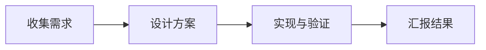

<!-- layout: cover -->
# 把想法讲清楚

### 用 Markdown，做一场好演示

文字是主角，设计只负责让它更清晰。

---

<!-- layout: statement -->
# 一页只讲一个判断。

用标题说结论，再用事实支撑它。

---

<!-- layout: split -->
# 从问题走向方案

### 问题

- 信息散落在各处
- 汇报前还在调整排版

<!-- column -->

### 方案

- 在 Markdown 中整理观点
- 用固定版式保持一致

---

# 让过程看得见



---

# 让数据说话

```chart
type: bar
title: 活动参与人数
labels: 第一组, 第二组, 第三组, 第四组
values: 18, 25, 22, 31
```

---

# 代码也值得被好好展示

```js
function makeSlides(ideas) {
  return ideas.map((idea) => ({
    title: idea.point,
    body: idea.evidence,
  }));
}
```

---

<!-- layout: section -->
# 现在，轮到你了

用单独一行的 `---` 开始下一页。
